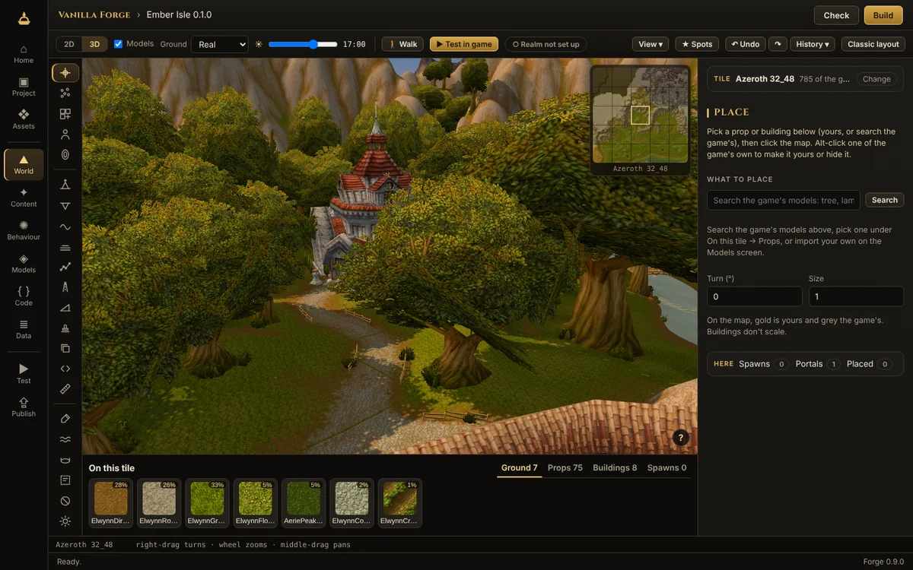
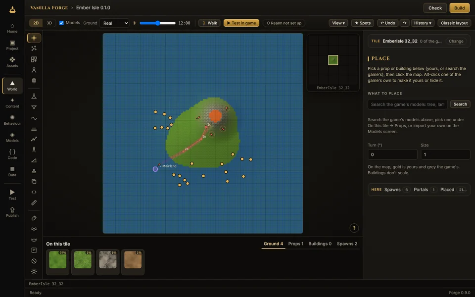
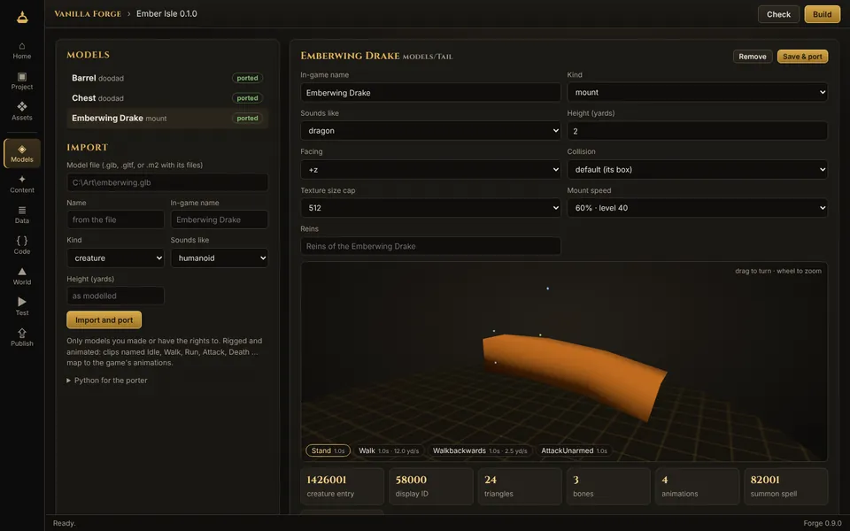
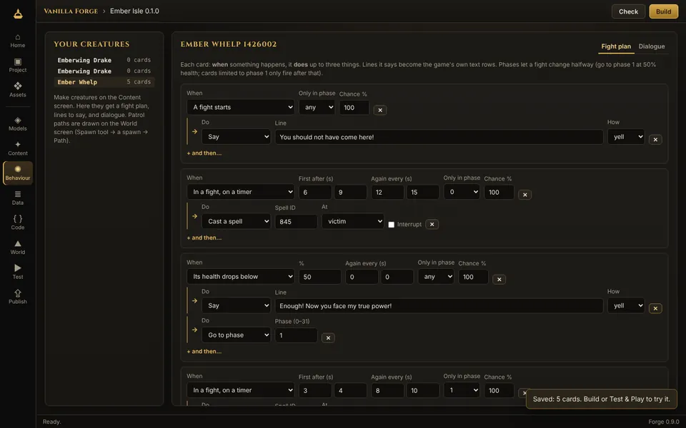
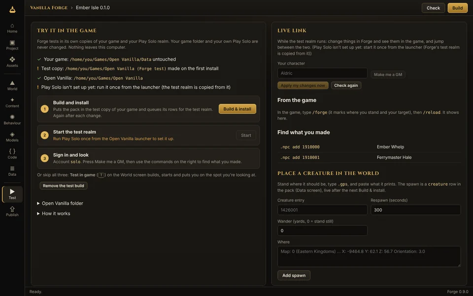

# Vanilla Forge

**The creator app for Open Vanilla.** Shape the world, bring your own models, write creatures, quests, items and addons, walk them in game in one click, and publish them as a pack a realm can install. One app instead of a shelf of modding tools: no hex editing, no copying files by hand.

> **Early access, 0.9.0.** Windows. Free.



## What it does

- **World:** sculpt terrain (raise, lower, smooth, flatten), paint ground textures, cut holes, paint water and lava, set zone areas, and place the game's own buildings and props or your own models. Edited tiles get matching server ground and collision, so creatures walk and line of sight works.
- **Models:** import `.glb`/`.gltf` as creatures, mounts or props (the bundled Model Porter), with a live 3D preview as the game will show it.
- **Content:** wizards for creatures with drops, quests, items and vendors; a Data editor for any world-table row or client DBC record, with install and rollback SQL.
- **Addon Studio:** a code editor with Lua 5.0 checks and a fake 1.12 client that runs your addon.
- **Test & Play:** builds into a *copy* of your game and a *copy* of Play Solo, never your real folders, and back out again.
- **Publish:** a stricter check, then a signed `.ovpack` that a realm's staff can verify and install.

| | |
|---|---|
|  |  |
|  |  |

## Get it

Download the installer from the [Forge page](https://openvanilla.app/forge.html) or the latest `forge-v*` release of [Open Vanilla](https://github.com/orionopenwow/OpenVanilla/releases). You need your own Vanilla game client (build 5875); Forge reads it and never changes it.

Your test server runs on your own PC: see [Your own test server](https://openvanilla.app/forge-server.html).

## Build from source

Needs Rust (stable); the desktop app on Windows also needs WebView2 (built into Windows 10/11).

```
cd forge
cargo test                                   # core tests
cargo run -p openvanilla-forge               # the desktop app
cargo run -p forge-cli -- serve              # or the app in a browser at http://127.0.0.1:8777
cargo run -p forge-cli -- new MyPack --template pack --name "My Pack"
cargo run -p forge-cli -- publish MyPack     # a signed .ovpack
```

The bundled Model Porter is in `tools/modelport` (Python 3.10+, numpy, Pillow). Details: [forge/README.md](forge/README.md) and [forge/CHANGELOG.md](forge/CHANGELOG.md).

## Part of Open Vanilla

[Open Vanilla](https://github.com/orionopenwow/OpenVanilla) is a free, open-source, community-built Vanilla project ([openvanilla.app](https://openvanilla.app/), [Discord](https://discord.gg/r6nj5p8U4)). Its products:

- [Vanilla Forge](https://github.com/orionopenwow/vanilla-forge) (this one): The Open Vanilla creator app: maps, models, creatures, quests, items and addons, tested in a copy of your game and published as a signed pack.
- [Vanilla Agents](https://github.com/orionopenwow/vanilla-agents): Your AI coding helpers as heroes in a cosy inn: you roam, they work, a checker verifies every quest.
- [Herald](https://github.com/orionopenwow/herald): The Open Vanilla Discord bot, the in-game World chat bridge, and Herald Autopilot: he plays a character for you, simulates gear and learns from play.
- [Open Vanilla Server](https://github.com/orionopenwow/openvanilla-server): Everything that runs a realm: the realm images and CMaNGOS patches, the web/asset service, Server Studio, Play Solo packs, the relay, and the turnkey Hetzner deployment.
- [Open Vanilla Launcher](https://github.com/orionopenwow/openvanilla-launcher): OpenVanilla.exe: play online, solo or in the browser, the Workshop, signed updates and live news; plus the release packaging.
- [Vanilla Remastered UI](https://github.com/orionopenwow/vanilla-remastered-ui): The in-game addon suite (WenillaCore, Quests, Transmog, Achievements, Guilds and the rest), Classic+ data, and the Workshop addon catalog.
- [openvanilla.app](https://github.com/orionopenwow/openvanilla-site): The Open Vanilla website (GitHub Pages) and the player manual.
- [Open Vanilla Devkit](https://github.com/orionopenwow/openvanilla-devkit): Test a change in seconds on your PC, try it against the live realm, and let a staging realm prove it first; plus the project's checks and tests.
- [Open Vanilla Agent Kit](https://github.com/orionopenwow/openvanilla-agent-kit): Let an AI coding agent change your copy of Open Vanilla for you: addons, interface, your own realm's rates and NPCs.
- [Open Vanilla Art & Tools](https://github.com/orionopenwow/openvanilla-art-tools): Art sources, UI kits and the generator scripts behind the launcher, site and addon artwork; plus the project's maintenance tools.

## License

MIT: see [LICENSE](LICENSE).

## About this repository

This repository is published from **Open Vanilla** (commit `e11f02fd65`: duels_up.sh: put back Duels Lite and everything 4e717e7 overwrote; keep only its combos.json mount). Changes are made there and arrive here with each release, so please open issues and pull requests on [Open Vanilla](https://github.com/orionopenwow/OpenVanilla/issues).

World of Warcraft is a trademark of Blizzard Entertainment, Inc. Open Vanilla is an independent fan project, not affiliated with or endorsed by Blizzard Entertainment. No Blizzard game files are included: you need your own.
